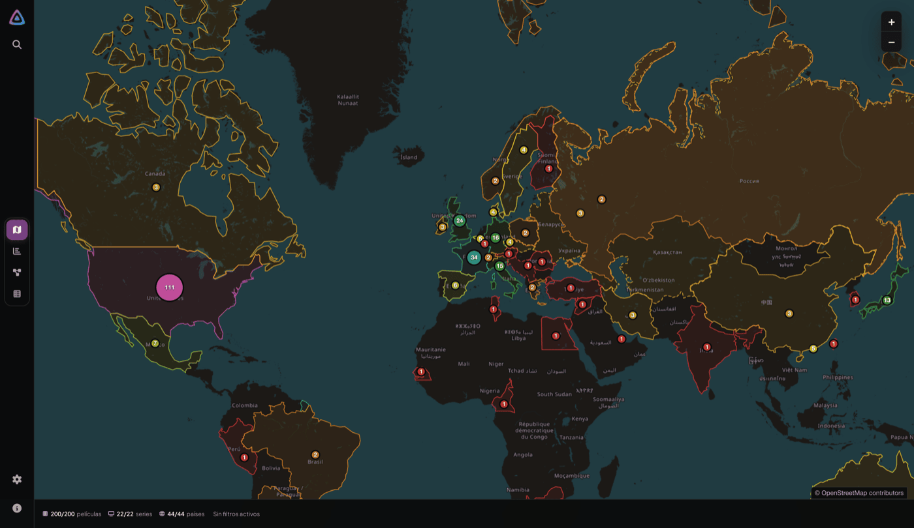
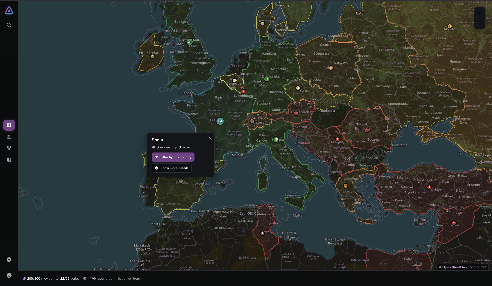
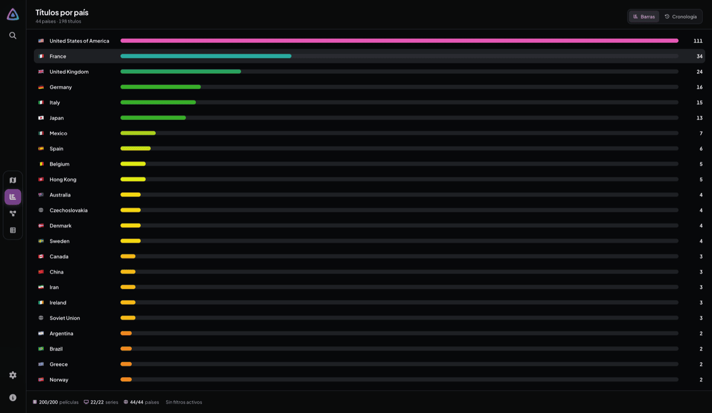
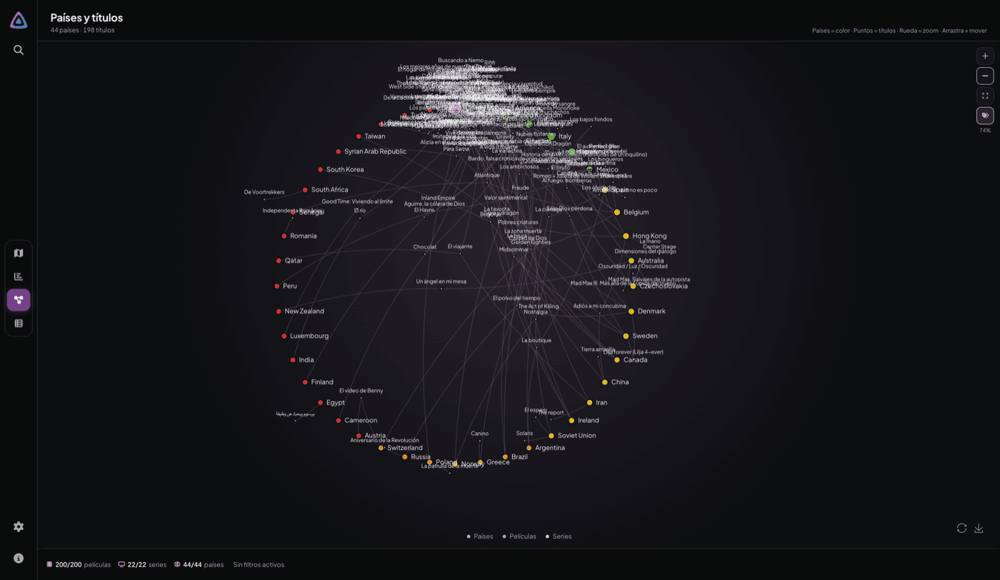
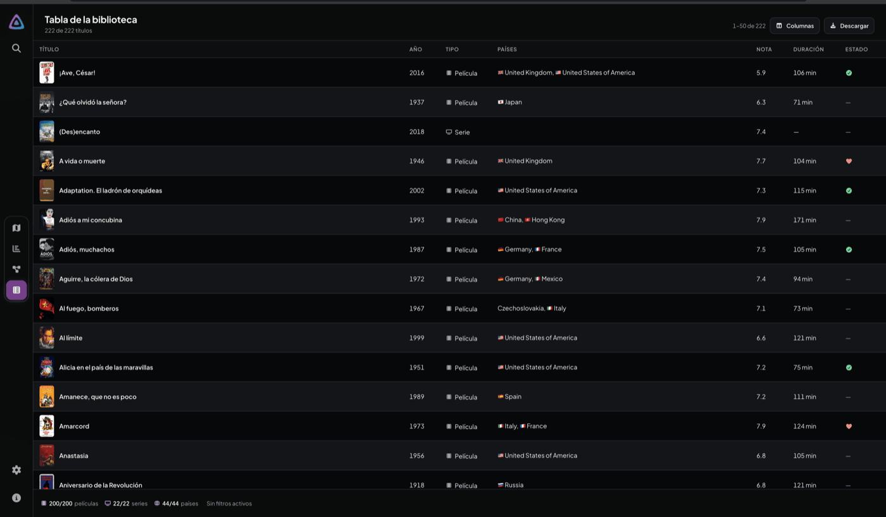
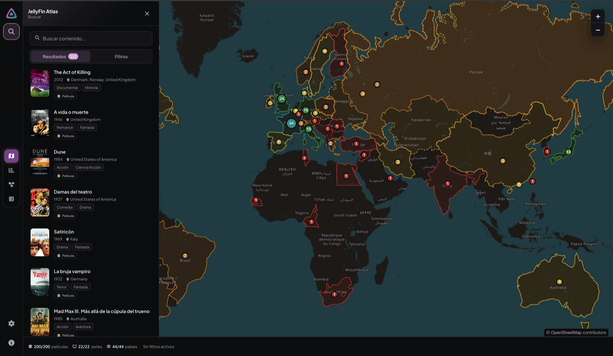
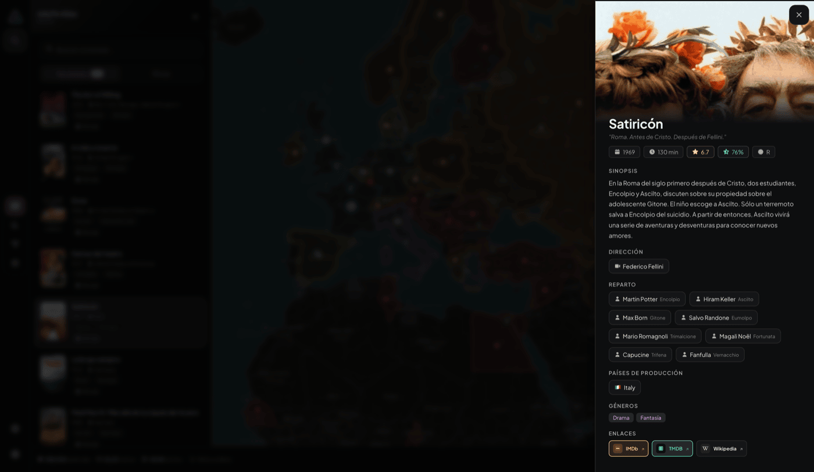

# JellyFin Atlas 🌍


**Explore your Jellyfin library on an interactive world map.**



JellyFin Atlas is a companion app for Jellyfin. It reads your library metadata and shows it from four angles: where your titles were produced, how the collection grew over time, how countries and titles connect, and a sortable table with exports.

It only **reads** from Jellyfin. it never modifies your library.

- One Jellyfin server per instance.
- Runs next to Jellyfin with just Node.js, or as a Docker container.
- English and Spanish interface.
- light and dark themes.
- No accounts, no analytics. Nothing leaves your network except public Wikidata/Wikipedia lookups and the map tiles.
- Try it **without a Jellyfin server**: `pnpm dev` starts with a demo library.

## Contents

- [Features](#features)
- [Screenshots](#screenshots)
- [Quick start](#quick-start)
- [Configuration](#configuration)
- [Using the app](#using-the-app)
- [Development](#development)
- [Data sources](#data-sources)
- [Troubleshooting](#troubleshooting)
- [Contributing](#contributing)
- [License](#license)

## Features

- **Map** — one marker per production country, sized by title count, with current and historical borders and filming-city dots from Wikidata. Click a marker to see the country and its titles.
  
- **Charts** — horizontal bars per country and a timeline by production year. Click a bar or a year to filter the whole app.
  
- **Graph** — an interactive network of countries and titles. Zoom, pan and drag nodes; click a country or a title to open it.
  
- **Table** — every title with poster, flags, year, rating, runtime and watch state. Sort it, pick the visible columns, and export what you see to **CSV, JSON or PDF**.
  
- **Filters** — search plus year, type, watch state, favorites, continue watching, countries and directors. All of it combines, and the state lives in the URL, so any view can be bookmarked or shared.
  
- **Details** — synopsis, cast, directors, genres, ratings and links to Jellyfin, IMDb, TMDB and Wikipedia. Person chips open their own dialog with a filmography.
  
- **Country panel** — flag, coat of arms and facts from Wikidata, plus the titles produced there.

## Screenshots

Taken with the demo library, dark theme and Spanish interface.

| Map                                                                                                                                                             | Chart                                                                                                                                                          |
| --------------------------------------------------------------------------------------------------------------------------------------------------------------- | -------------------------------------------------------------------------------------------------------------------------------------------------------------- |
|                |              |
| **Graph**                                                                                                                                                       | **Table**                                                                                                                                                      |
|  |   |
| **Search**                                                                                                                                                      | **Title details**                                                                                                                                              |
|                            |  |

## Quick start

### 1. Try the demo (no Jellyfin needed)

```bash
git clone https://github.com/angelespejo/jellyfin-atlas.git
cd jellyfin-atlas
pnpm install
pnpm dev
```

Open <http://localhost:5143>. You get a bundled demo library and the app never contacts a real Jellyfin server.

> **Requirements:** Node.js 22 or newer, and pnpm (`corepack enable` is the easiest way to get the pinned version).

### 2. Connect your Jellyfin server

You need a running Jellyfin server with a scanned library. If someone else administers it, ask them for the URL and an API key — you don't need their password.

**a. Create an API key**

1. In Jellyfin go to **Dashboard → Administration → API Keys** (on older versions, Administration is under **Advanced**).
2. Click **+**, name it `JellyFin Atlas` and save.
3. Copy the key.

**b. Configure and run**

```bash
cp .env.example .env
# edit .env: set JELLYFIN_URL and JELLYFIN_API_KEY
pnpm dev-remote
```

Open <http://localhost:5143>. The dev server always uses port 5143: `pnpm dev` = demo data, `pnpm dev-remote` = your server.

**c. Production build**

```bash
pnpm build
pnpm start
```

Open <http://localhost:3000> (change it with `PORT=8080 pnpm start`). Credentials are read at startup, so you can edit `.env` and restart — no rebuild needed.

### 3. Install with Docker

**Docker Compose (recommended)**

```bash
git clone https://github.com/angelespejo/jellyfin-atlas.git
cd jellyfin-atlas
cp .env.example .env     # set JELLYFIN_URL and JELLYFIN_API_KEY
docker compose up -d --build
```

**Prebuilt image** (published on version tags, Linux amd64/arm64)

```bash
docker run -d \
  --name jellyfin-atlas \
  --restart unless-stopped \
  -p 3000:3000 \
  -e JELLYFIN_URL=http://192.168.1.10:8096 \
  -e JELLYFIN_API_KEY=your-api-key \
  ghcr.io/angelespejo/jellyfin-atlas:latest
```

**Demo inside Docker**

```bash
docker run -d -p 3000:3000 -e JELLYFIN_MOCK=true ghcr.io/angelespejo/jellyfin-atlas:latest
```

Two things that catch everyone out:

- `localhost` inside the container is the container itself. Use the LAN IP of the Jellyfin machine, `http://host.docker.internal:8096`, or the Compose service name (`http://jellyfin:8096`).
- The container listens on `PORT` (default `3000`); expose it with `-p`.

`GET /api/health` reports the app version, demo mode and whether Jellyfin is reachable. It is also the container healthcheck.

## Configuration

Copy `.env.example` to `.env` (git-ignored). Variables are read at **runtime**: change one and restart the app, no rebuild required.

| Variable              | Required | Description                                                                                                                     |
| --------------------- | -------- | ------------------------------------------------------------------------------------------------------------------------------- |
| `JELLYFIN_URL`        | Yes      | Jellyfin base URL with port and **no trailing slash** (`http://192.168.1.10:8096`).                                             |
| `JELLYFIN_PUBLIC_URL` | No       | Browser-facing URL for “Watch in Jellyfin” links. Defaults to `JELLYFIN_URL`; set it when the server uses an internal hostname. |
| `JELLYFIN_API_KEY`    | Yes      | API key created in Jellyfin. Grants full access to the server, so keep it secret.                                               |
| `JELLYFIN_USER_ID`    | No       | User whose watched/favorite/continue-watching state is used. Defaults to the first user Jellyfin returns.                       |
| `JELLYFIN_MOCK`       | No       | `true` serves the demo library instead of Jellyfin. `pnpm dev` enables it automatically.                                        |
| `PORT`                | No       | Port for the production server. Defaults to `3000`. Ignored by the dev server.                                                  |

The API key is used only by the server and never sent to the browser.

## Using the app

### Views

Switch views from the bottom of the left action rail (the map stays loaded while you do). See [Screenshots](#screenshots) for each one.

- **Chart** has two sub-tabs: **Bars** (countries) and **Timeline** (years).
- **Graph** uses a force layout for small libraries and a radial one for large ones, so it stays readable.
- **Table** always shows the title column; the others are toggled from the column menu. Exports follow the visible columns and the current sort/filter.

### Search and filters

Open the sidebar with the search button (`Ctrl/⌘ + K`) or the filters button. **Results** searches titles; **Filters** groups year, type, status, countries and directors. The bottom bar lists active filters and how many movies, series and countries match.

The country drawer and the person filmography have their own search boxes that only narrow that list — they never change the global filters.

### Keyboard shortcuts

`⌘`/`Ctrl` and `⌥`/`Alt` are grouped so the same key works on macOS and Windows/Linux. Shortcuts are ignored while typing in a field.

| Action                            | Shortcut                      |
| --------------------------------- | ----------------------------- |
| Search the library                | `Ctrl/⌘ + K`                  |
| Open the filters panel            | `Alt/⌥ + F`                   |
| Map / Chart / Graph / Table views | `Alt/⌥ + M` / `G` / `J` / `T` |
| Show or hide filming cities       | `Alt/⌥ + C`                   |
| Reset filters and search          | `Alt/⌥ + R`                   |
| Clear all filters                 | `Alt/⌥ + Backspace`           |
| Reload library data               | `Alt/⌥ + L`                   |
| Clear the local cache             | `Alt/⌥ + Shift + L`           |
| Close the open dialog or panel    | `Esc`                         |

### Language and theme

**Settings** (`Alt/⌥ + 2`) switches language (Automatic, English, Español) and theme (System, Light, Dark). Both choices are remembered.

With the demo library, the **About** dialog shows a _Demo data_ badge so demo screenshots are never mistaken for a real library.

## Development

### Demo library

`pnpm dev` runs Vite in mock mode with a snapshot of a real library (`src/routes/api/_shared/mock/library.json`). No server, key or internet needed: it covers countries, years, genres, ratings, cast, watch state and artwork.

- `pnpm mock:build` regenerates the snapshot from **your** server (up to 200 movies and 50 series; watch state is synthetic and no server URL is stored).
- Posters and portraits go to `.dovenv/mock/images/` (git-ignored, outside `static/`, so they never reach `pnpm build` or Docker). Without them the app draws generated SVG artwork. Use `--no-images` or `--movies=100` to trim.
- Demo mode never writes the library cache, so real and demo data can't mix.

Use `pnpm dev-remote` to work against your real server instead.

### Commands

```bash
pnpm dev             # demo library, no Jellyfin needed (port 5143)
pnpm dev-remote      # real server from .env (port 5143)
pnpm mock:build      # regenerate the demo snapshot + images from .env
pnpm check           # Svelte/TypeScript diagnostics
pnpm lint            # oxlint (also: pnpm lint:fix)
pnpm format          # Prettier (also: pnpm format:check)
pnpm test:e2e        # Playwright smoke tests against the demo library
pnpm push            # guided: pick files, write a Conventional Commit, choose the branch to push
pnpm build           # production build
pnpm start           # run the production build (loads .env)
pnpm geo:build       # regenerate static/geo/* (needs network)
pnpm countries:build # regenerate the compact client country index
pnpm release         # bump version, update CHANGELOG.md, tag and publish
```

Run `pnpm exec prettier --write <path>` on the files you touch. The repo has some pre-existing lint and format warnings; just make sure your change adds none.

### Releasing

Releases are automated with [release-it](https://github.com/release-it/release-it) and [Conventional Commits](https://www.conventionalcommits.org/): write commit messages as `feat:`, `fix:` or `docs:` and the changelog writes itself. `pnpm push` helps with that: it asks which files to add, then the type and scope (both picked from the lists in [`.dovenv/commits.ts`](./.dovenv/commits.ts), each type carrying an emoji) and the description, e.g. `fix(map): 🐛 correct marker size`, then the branch to push to (or skip the push). The list of types and their changelog sections lives in [`.dovenv/commits.ts`](./.dovenv/commits.ts) and is shared by both.

```bash
pnpm changelog:preview   # print the entry the next release would get
pnpm release:dry         # full dry run, changes nothing
GITHUB_TOKEN=… pnpm release
```

`pnpm release` bumps `package.json`, updates [`CHANGELOG.md`](./CHANGELOG.md), commits, tags `vX.Y.Z`, pushes and opens the GitHub release. The tag also triggers the Docker publish workflow. `pnpm check` must pass first.

### Code guidelines

- **TypeScript and Svelte only.** Rune state lives in `.svelte.ts` files; styles use the CSS custom properties in `src/app.css` (no Tailwind).
- Reuse the primitives in `src/lib/components/*` and `src/lib/ui/*` before adding new markup or one-off styles.
- Accessibility is part of done: real buttons and links, keyboard-operable dialogs, translated `aria-label`s, `prefers-reduced-motion` for animations.
- Don't add a dependency for a few lines you can write yourself, and never bypass the `pnpm audit` gate.
- UI text goes through Paraglide: add the key to both `src/locales/en.json` and `src/locales/es.json`, never to the generated `.dovenv/i18n`.
- Never render remote data with `{@html}`.

Full architecture notes: [`AGENTS.md`](./AGENTS.md).

## Data sources

The map and the extra information come from open datasets. Keep their attributions if you reuse or redistribute the assets.

- **OpenStreetMap** — base map tiles ([copyright](https://www.openstreetmap.org/copyright), ODbL).
- **Natural Earth** — current country borders ([public domain](https://www.naturalearthdata.com/about/terms-of-use/)).
- **historical-basemaps** — approximate historical borders ([GPL-3.0](https://github.com/aourednik/historical-basemaps)).
- **Wikidata** — filming locations and country facts (CC0).
- **Wikipedia** — country descriptions and links (CC BY-SA).

Your Jellyfin metadata stays on your server. Only country/city names and IDs are sent to Wikidata/Wikipedia — never personal data or watch history.

## Troubleshooting

**The app shows a connection error**

- Using `pnpm dev`? It never contacts Jellyfin — use `pnpm dev-remote`.
- Check the server: `curl http://your-server:8096/System/Info/Public` should answer.
- Re-check `JELLYFIN_URL` and `JELLYFIN_API_KEY`, then restart the process.
- Check `/api/health` to see whether Jellyfin is configured and reachable.
- A self-signed HTTPS certificate may be rejected until the system trusts it.
- In Docker, `localhost` is the container itself.

**The map is empty or countries are missing**

Countries come from the production locations in Jellyfin metadata. Make sure your library was scanned with a metadata provider that fills them in.

**Watch state looks wrong**

Set `JELLYFIN_USER_ID` and restart. Then reload with `Alt/⌥ + L` or clear the cache with `Alt/⌥ + Shift + L`. Demo data uses synthetic watch state and is never cached.

**Port already in use**

Port 5143 is fixed in development. For production run `PORT=8080 pnpm start` (or change it in `.env`/Compose) and map the same port in Docker.

**Some titles have no filming cities**

Filming locations come from Wikidata and coverage is partial. Country markers always come from Jellyfin metadata; the demo uses a small offline city sample.

## Contributing

Contributions, bug reports and ideas are welcome. For a large change, open an issue first — it avoids duplicated work.

- **Bug**: what you did, what you expected, what happened, your Jellyfin version and any console or server logs.
- **Feature**: describe the problem you want to solve, not only the solution.
- **Pull request**: fork, branch, keep the change focused and describe it in the PR.

```bash
pnpm install
pnpm dev               # demo library
# or, against your own server:
cp .env.example .env   # fill in URL and API key
pnpm dev-remote
```

CI runs `pnpm check`, `pnpm build` and the Playwright tests; the Docker image is published to GHCR on version tags.

## License

**GNU General Public License v3.0** — see [LICENSE](LICENSE).

[](LICENSE)

---

Made by **PigeonPosse**, a code collective building practical tools.

| Name        | Role                         | GitHub                                         |
| ----------- | ---------------------------- | ---------------------------------------------- |
| Angelo      | Author, Design & Development | [@angelespejo](https://github.com/angelespejo) |
| PigeonPosse | Collective                   | [@pigeonposse](https://github.com/pigeonposse) |
